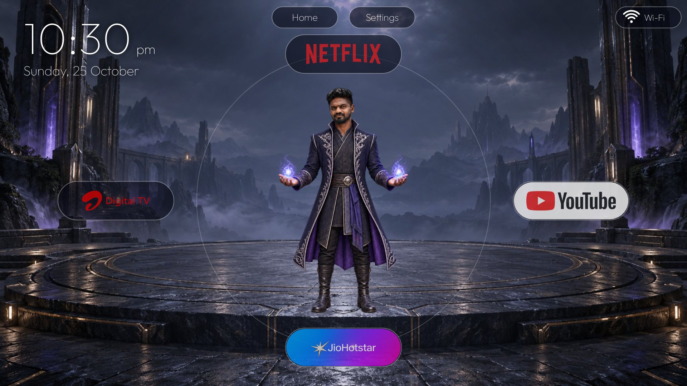
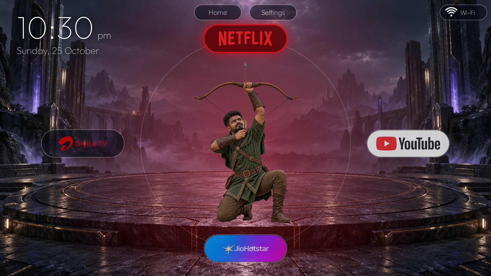
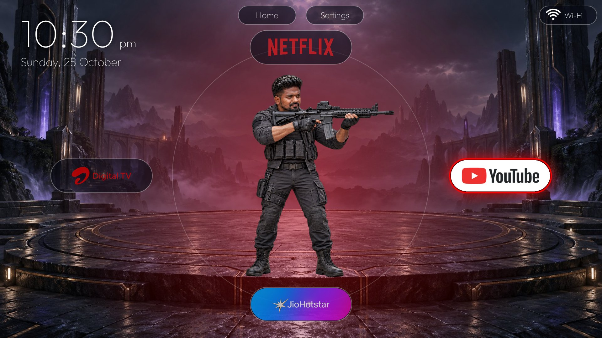
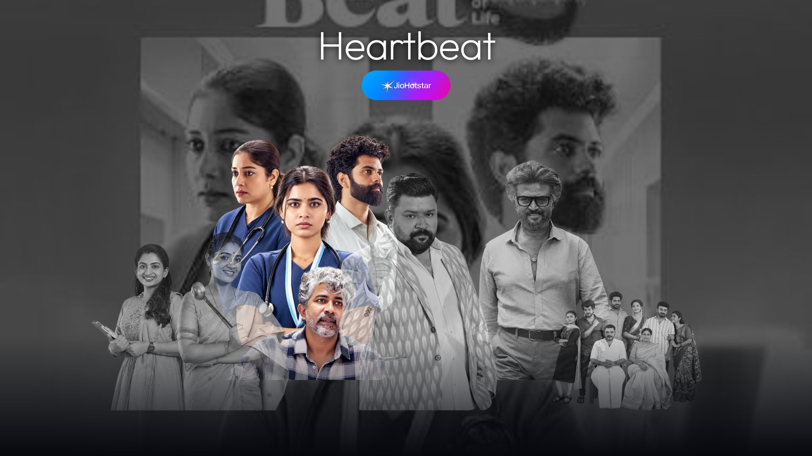
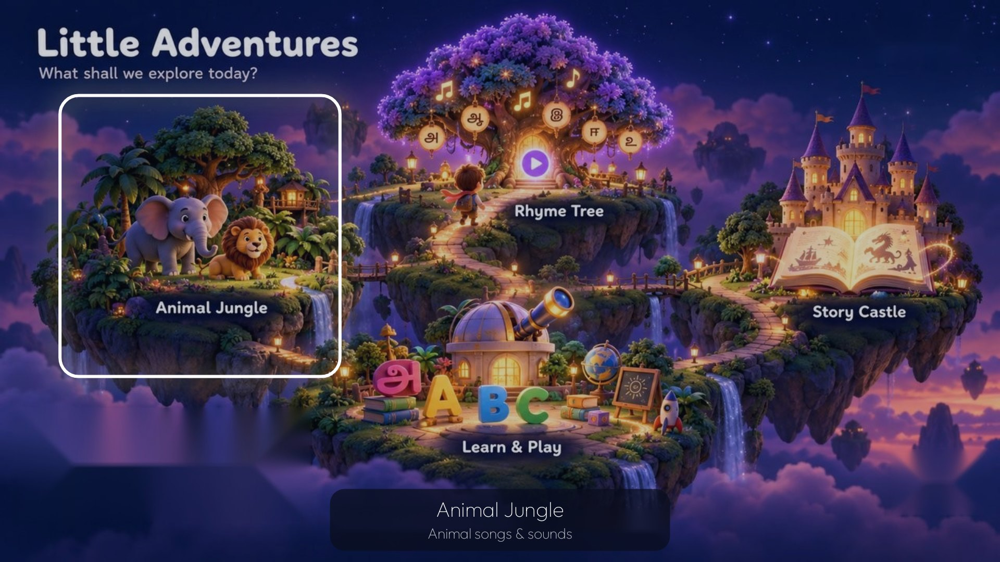

# Home-Personalised: a custom Android TV launcher

Replace your Android TV's cluttered home screen with one vertical page of three sections:

1. **Radial home**: a character in the middle, four big tiles around them (up, left, right, down). The character changes pose as you move. Top bar for Home, Settings and Wi-Fi, big clock and date.
2. **Favourites**: a line-up of your favourite shows. The selected one turns to colour, a dark scene fades in behind, and OK opens that show directly in its app.
3. **Kids**: four "worlds", each opening a YouTube playlist or channel.

It is plain Java with no dependencies (no Compose, no libraries), about 1,100 lines. Everything you would want to change (apps, shows, links, art) is in one file: [`app/src/main/assets/config.json`](app/src/main/assets/config.json).

Tested on a MediaTek Android TV 11 box (1920x1080). Not affiliated with Netflix, Google, YouTube or JioHotstar.



| | |
|---|---|
|  |  |
|  |  |

A step-by-step guide with all screenshots: [read it as a Google Doc](https://docs.google.com/document/d/1nbp7k6AMbDqXbM-XFs4I44dHl7jCqDczBt-6JmMC8LY/edit?usp=sharing), or download [docs/Home-Personalised-guide.docx](docs/Home-Personalised-guide.docx).

## Controls

| Key | Action |
|---|---|
| D-pad | Move the selection. Down past the last item (or Up past the first) scrolls to the next section. |
| OK | Open the selected app, show, HDMI input or playlist |
| Back | Deselect, or go back to section 1 |
| Home | Back to section 1 |

## Install

You need Android Studio (or the Android SDK), JDK 17 and `adb`.

1. On the TV, turn on Developer options and USB/Network debugging, then `adb connect <tv-ip>:5555`.
2. Create `local.properties` with your SDK path (forward slashes): `sdk.dir=C:/Users/you/AppData/Local/Android/Sdk`
3. Build and install:
   ```
   ./gradlew assembleDebug
   adb install -r app/build/outputs/apk/debug/app-debug.apk
   adb shell am start -n com.rabbit.tvhome/.HomeActivity
   ```

That gives you the launcher as an app. To make it the real Home screen, read [docs/TV-SETUP.md](docs/TV-SETUP.md). Making it default needs a few system apps disabled, and that guide also covers undoing everything.

## Make it yours

Open `config.json`:

- `apps`: the streaming apps (label, Android package names, logo, colour).
- `radial`: what the up, left, right and down tiles do (`app` or `hdmi`) and the pose images.
- `favourites`: each show has a title, the app, a deep `link`, a cut-out character, a scene, and its position in the line-up (`x`, `y`, `w`, `h` as fractions, `row` front or back).
- `kids.worlds`: four titles with a YouTube `link`.

Deep links are plain `https` links opened with the chosen app (`ACTION_VIEW` plus the app's package). If the app does not accept the link, it opens the app normally. Notes from testing:

- JioHotstar opens the show page, but on a cold start it shows "Who's watching?" first. Once it is running, later links go straight to the show.
- Netflix opens genre pages, not single titles.

Replace the images in `app/src/main/assets` (`radial/`, `fav/`, `scenes/`, `kids/`, `logos/`) with your own. Cut-outs and poses should be transparent PNGs. `tools/preview.py` renders approximate previews on your PC so you can check placement without a TV (needs Pillow: `python tools/preview.py out_folder`).

## Included art

The logos and show art in this repo are only there so you can see how it looks. They belong to their owners. Replace every image in `logos/`, `fav/` and `scenes/` with your own before you use this on your TV or publish a fork. See [NOTICE.md](NOTICE.md).

## Licence

Code: MIT, see [LICENSE](LICENSE).

## Credits

- **[CleanYourTV](https://github.com/Gathin23/cleanyourtv)** by Gathin23 (MIT licence, [cleanyour.tv](https://cleanyour.tv)): the open-source project this one grew out of. Its debloat approach and base launcher were the starting point and reference.
- **"Your TV, Your Way"**, the guide behind the "I hacked my TV using Claude" reel: the idea of a black-and-white favourites line-up with per-show scenes and deep links, and the step-by-step prompt-driven way of building it, come from that guide. [Read it here](https://docs.google.com/document/d/1JrGoSIpS25907k3UYvtLf_s34vReFVZV/mobilebasic).
- Typeface: Outfit (SIL Open Font License). Built with [Claude Code](https://claude.com/claude-code).

Created by Haroon Haneef.
